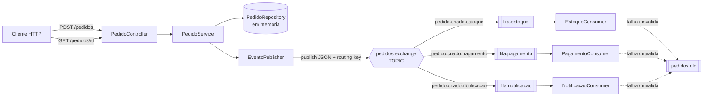

# Documento de Design

## Visão Geral

Este documento descreve o design de um sistema de pedidos com processamento assíncrono baseado em **Spring Boot**, **API REST** e **RabbitMQ**. O objetivo é manter a solução **simples e didática**: uma aplicação Spring Boot única que expõe endpoints REST para cadastro e consulta de pedidos, publica eventos em uma exchange do tipo TOPIC e possui três consumidores independentes (estoque, pagamento e notificação).

Decisões principais de simplicidade:

- **Persistência em memória** para a consulta de pedidos (um `Map` em memória encapsulado em um repositório). Não há banco de dados externo.
- **Consumidor de notificação simulado via log** — nenhum e-mail real é enviado.
- **Retry + Dead Letter Queue básicos** usando os recursos nativos do Spring AMQP (retry do listener container + DLQ por argumentos de fila). Sem orquestração avançada.
- **Estrutura padrão Spring Boot + Spring AMQP**, sem padrões corporativos avançados.

O fluxo geral é:

```
Cliente -> POST /pedidos -> PedidoController -> PedidoService -> PedidoRepository (memória)
                                                      |
                                                      v
                                              EventoPublisher
                                                      |
                                                      v
                                        RabbitMQ (Exchange TOPIC "pedidos.exchange")
                                           |             |              |
                                 fila.estoque   fila.pagamento   fila.notificacao
                                           |             |              |
                                 EstoqueConsumer  PagamentoConsumer  NotificacaoConsumer
                                           \_____________|______________/
                                                         |  (mensagem inválida / falha persistente)
                                                         v
                                                 Dead Letter Queue
```

## Arquitetura

### Diagrama de Componentes



### Camadas da Aplicação

1. **Camada Web (REST)**: `PedidoController` expõe `POST /pedidos` e `GET /pedidos/{id}`. Faz validação de entrada e tradução de erros para códigos HTTP.
2. **Camada de Serviço**: `PedidoService` orquestra a criação do pedido (gera identificador, grava em memória) e aciona a publicação do evento.
3. **Camada de Mensageria (Produtor)**: `EventoPublisher` serializa o `EventoPedido` em JSON e publica na exchange TOPIC com a routing key adequada.
4. **Camada de Mensageria (Consumidores)**: `EstoqueConsumer`, `PagamentoConsumer` e `NotificacaoConsumer` escutam suas filas de forma independente.
5. **Infraestrutura RabbitMQ**: `RabbitConfig` declara exchange, filas, bindings, DLQ e o conversor JSON.

### Topologia RabbitMQ

| Recurso | Nome | Tipo | Observação |
|---|---|---|---|
| Exchange | `pedidos.exchange` | topic | Roteamento por routing key |
| Fila | `fila.estoque` | durable | Binding `pedido.criado.estoque` |
| Fila | `fila.pagamento` | durable | Binding `pedido.criado.pagamento` |
| Fila | `fila.notificacao` | durable | Binding `pedido.criado.notificacao` |
| Exchange (DLX) | `pedidos.dlx` | direct | Dead Letter Exchange |
| Fila | `pedidos.dlq` | durable | Recebe mensagens mortas das três filas |

Para que um pedido seja entregue às três filas simultaneamente, a routing key publicada será `pedido.criado` e os bindings usarão o padrão `pedido.criado.*` **ou**, de forma ainda mais simples, cada fila terá o binding `pedido.criado` e a publicação usa essa chave única. Para fins didáticos adotaremos **uma routing key única `pedido.criado`** com as três filas vinculadas a esse padrão, de modo que todo pedido criado seja roteado às três filas. Isso satisfaz o roteamento por TOPIC mantendo a configuração enxuta.

Cada fila de processamento é declarada com os argumentos:

- `x-dead-letter-exchange = pedidos.dlx`
- `x-dead-letter-routing-key = pedidos.dlq`

Assim, mensagens rejeitadas após esgotar as tentativas são encaminhadas automaticamente para a DLQ.

### Plugin de Management

O RabbitMQ será executado via Docker (imagem `rabbitmq:3-management`), que já habilita o plugin **RabbitMQ Management** na porta `15672`. Através dele é possível visualizar a exchange, as filas, a DLQ, a quantidade de mensagens enfileiradas e a taxa de consumo.

## Componentes e Interfaces

### PedidoController

```java
@RestController
@RequestMapping("/pedidos")
public class PedidoController {
    // POST /pedidos  -> 201 Created + { "id": "..." }
    // GET  /pedidos/{id} -> 200 OK + Pedido | 404 Not Found
}
```

Responsabilidades:
- Receber e validar o corpo da requisição (`@Valid`).
- Retornar `201` com o identificador em caso de sucesso.
- Retornar `400` quando faltarem campos obrigatórios (tratado por `@Valid` + handler global).
- Retornar `404` quando o pedido consultado não existir.
- Retornar `502` quando a publicação no RabbitMQ falhar.

### PedidoService

```java
public interface PedidoService {
    Pedido criarPedido(CriarPedidoRequest request); // gera id, persiste, publica evento
    Optional<Pedido> buscarPorId(String id);
}
```

### EventoPublisher

```java
public interface EventoPublisher {
    void publicar(EventoPedido evento); // serializa JSON e publica na exchange TOPIC
}
```

- Usa `RabbitTemplate` com `Jackson2JsonMessageConverter`.
- Em caso de falha na publicação, lança uma exceção que o controller traduz para `502`.

### Consumidores

Os três consumidores seguem a mesma estrutura, diferindo apenas na fila escutada e na ação simulada:

```java
@RabbitListener(queues = "fila.estoque")
public void consumir(EventoPedido evento) {
    // processa estoque, registra log com evento.getId(), confirma (ack automatico)
}
```

- O `ack` é automático (modo `AUTO` do Spring AMQP): sucesso = ack; exceção = nack/retry.
- Cada consumidor registra em log o identificador do pedido processado.
- Validação de conteúdo do evento antes do processamento; conteúdo inválido lança exceção não recuperável, encaminhando à DLQ.

### RabbitConfig

Declara, via beans, a exchange TOPIC, as três filas (com argumentos de DLQ), a DLX, a DLQ, os bindings e o `Jackson2JsonMessageConverter`. Também configura a política de retry do listener container.

### Tratamento de Erros Global

`GlobalExceptionHandler` (`@RestControllerAdvice`) mapeia:
- `MethodArgumentNotValidException` -> `400` com lista de campos ausentes/invalidos.
- `PedidoNaoEncontradoException` -> `404`.
- `PublicacaoEventoException` -> `502`.

## Modelos de Dados

### CriarPedidoRequest (entrada REST)

| Campo | Tipo | Obrigatório | Validação |
|---|---|---|---|
| `cliente` | String | Sim | `@NotBlank` |
| `itens` | List\<ItemPedido\> | Sim | `@NotEmpty` |
| `valorTotal` | BigDecimal | Sim | `@NotNull`, `@Positive` |

### ItemPedido

| Campo | Tipo | Obrigatório | Validação |
|---|---|---|---|
| `produto` | String | Sim | `@NotBlank` |
| `quantidade` | int | Sim | `@Positive` |

### Pedido (entidade em memória)

| Campo | Tipo | Descrição |
|---|---|---|
| `id` | String (UUID) | Identificador único gerado na criação |
| `cliente` | String | Dados do cliente |
| `itens` | List\<ItemPedido\> | Itens do pedido |
| `valorTotal` | BigDecimal | Valor total |
| `dataCriacao` | Instant | Momento da criação |

### EventoPedido (mensagem JSON publicada)

| Campo | Tipo | Descrição |
|---|---|---|
| `id` | String | Identificador do pedido |
| `cliente` | String | Dados do cliente |
| `itens` | List\<ItemPedido\> | Itens do pedido |
| `valorTotal` | BigDecimal | Valor total |
| `dataCriacao` | Instant | Momento da criação |

O `EventoPedido` é um POJO Java serializado/desserializado com Jackson. É este objeto que trafega pelo RabbitMQ e sobre o qual se aplica a propriedade de round-trip do Requisito 9.

### PedidoRepository (em memória)

```java
public interface PedidoRepository {
    Pedido salvar(Pedido pedido);
    Optional<Pedido> buscarPorId(String id);
}
```

Implementação baseada em `ConcurrentHashMap<String, Pedido>`.

## Propriedades de Corretude

*Uma propriedade é uma característica ou comportamento que deve ser verdadeiro em todas as execuções válidas de um sistema — essencialmente, uma afirmação formal sobre o que o sistema deve fazer. As propriedades servem de ponte entre especificações legíveis por humanos e garantias de corretude verificáveis por máquina.*

A partir da análise dos critérios de aceitação, a maior parte do sistema envolve infraestrutura RabbitMQ (configuração de exchange, filas, bindings, DLQ e retry) e endpoints REST, que serão cobertos por testes de contexto (smoke), testes de integração e testes example-based. As propriedades universais aplicáveis a este sistema são as seguintes:

### Property 1: Round-trip de serialização JSON do Evento de Pedido

*Para qualquer* `EventoPedido` válido, serializá-lo em JSON e depois desserializá-lo SHALL produzir um `EventoPedido` equivalente ao original (nenhum dado perdido ou corrompido).

**Validates: Requirements 2.2, 9.1, 9.2, 9.3**

### Property 2: Unicidade dos identificadores de pedido

*Para qualquer* sequência de pedidos válidos criados, todos os identificadores atribuídos SHALL ser não-vazios e mutuamente distintos (sem colisões).

**Validates: Requirements 1.3**

### Property 3: Round-trip de criação e consulta de pedido

*Para qualquer* pedido válido, após criá-lo e consultá-lo pelo seu identificador, os dados retornados SHALL ser equivalentes aos dados informados na criação.

**Validates: Requirements 1.4**

### Property 4: Validação de conteúdo do evento

*Para qualquer* `EventoPedido`, a validação de conteúdo SHALL rejeitar o evento se, e somente se, ele violar as regras de conteúdo (cliente em branco, lista de itens vazia ou valor total não positivo), encaminhando os rejeitados ao fluxo de Dead Letter Queue.

**Validates: Requirements 7.2**

## Tratamento de Erros

| Situação | Origem | Tratamento | Resposta/Destino |
|---|---|---|---|
| Campos obrigatórios ausentes | REST (entrada) | `@Valid` + `GlobalExceptionHandler` | HTTP 400 com lista de campos |
| Pedido inexistente na consulta | REST (GET) | `PedidoNaoEncontradoException` | HTTP 404 |
| Falha ao publicar no RabbitMQ | Produtor | `PublicacaoEventoException` + log | HTTP 502 |
| Mensagem não desserializável | Consumidor | Erro de conversão (não recuperável) | Encaminhada à DLQ + log |
| Evento com conteúdo inválido | Consumidor | Validação lança exceção não recuperável | Encaminhada à DLQ + log do motivo e id |
| Erro transitório no processamento | Consumidor | Retry do listener container até limite configurável | Após esgotar tentativas: DLQ |

Configuração de retry (Spring AMQP), valores padrão simples e configuráveis via `application.yml`:

```yaml
spring:
  rabbitmq:
    listener:
      simple:
        acknowledge-mode: auto
        retry:
          enabled: true
          max-attempts: 3        # limite de tentativas configuravel (Req 7.5)
          initial-interval: 1000ms
        default-requeue-rejected: false  # mensagens rejeitadas vao para a DLQ
```

Mensagens não recuperáveis (erros de conversão/validação) são tratadas como rejeitadas e, com `default-requeue-rejected: false` combinado aos argumentos `x-dead-letter-*` das filas, são encaminhadas automaticamente à DLQ. Cada encaminhamento à DLQ registra em log o identificador da mensagem e o motivo da rejeição.

## Estratégia de Testes

A estratégia combina quatro tipos de teste, proporcionais à natureza de cada parte do sistema (a maior parte envolve infraestrutura RabbitMQ e endpoints, com um núcleo de lógica pura testável por propriedades).

### Testes Unitários (example-based)

- `PedidoController`: criação com corpo válido (201), campos ausentes (400), consulta inexistente (404), falha de publicação (502) — via `MockMvc` com serviço/publisher mockados.
- `EventoPublisher`: verificação de que `convertAndSend` é chamado na exchange `pedidos.exchange` com a routing key `pedido.criado` (RabbitTemplate mockado).
- Log de encaminhamento à DLQ: verificação de que motivo e id são registrados.

### Testes de Propriedade (property-based)

Serão implementados com **jqwik** (biblioteca de property-based testing para Java/JUnit 5). Não implementar PBT do zero. Cada teste:

- Executa **no mínimo 100 iterações** (`@Property` do jqwik usa 1000 por padrão, mantido acima do mínimo).
- Referencia a propriedade de design correspondente em comentário, no formato:
  `// Feature: sistema-pedidos-rabbitmq, Property {N}: {texto da propriedade}`

Mapeamento propriedade -> teste:

- **Property 1** (round-trip JSON): gerar `EventoPedido` válidos aleatórios, serializar com `Jackson2JsonMessageConverter`/`ObjectMapper` e desserializar; assertar equivalência com o original.
- **Property 2** (unicidade de ids): gerar listas de pedidos válidos, criar todos via serviço (com repositório em memória) e assertar que o conjunto de ids tem o mesmo tamanho da lista e nenhum id é vazio.
- **Property 3** (round-trip criar/consultar): gerar pedido válido, criar e buscar pelo id, assertar equivalência dos dados.
- **Property 4** (validação de conteúdo): gerar eventos válidos e inválidos (cliente em branco, itens vazios, valor não positivo) e assertar que a validação aceita os válidos e rejeita os inválidos.

### Testes de Integração

Com **Testcontainers** (contêiner `rabbitmq:3-management`) para validar o comportamento real do broker:

- Publicação de um `EventoPedido` resulta na entrega às três filas (estoque, pagamento, notificação).
- Consumidores são invocados com o evento e confirmam (ack) após sucesso.
- Payload inválido/não desserializável é encaminhado à DLQ.
- Erro transitório provoca novas tentativas até o limite configurado e, então, encaminhamento à DLQ.

### Testes de Smoke (contexto Spring)

Carregam o `ApplicationContext` e verificam a topologia declarada:

- Existência dos beans `TopicExchange` (`pedidos.exchange`), das três filas, da DLX/DLQ e dos bindings.
- Argumentos `x-dead-letter-exchange`/`x-dead-letter-routing-key` presentes nas filas de processamento.

### Monitoramento (verificação manual)

Os critérios do Requisito 8 (RabbitMQ Management) são verificados manualmente pela interface em `http://localhost:15672`, confirmando a presença da exchange, filas, DLQ, contagem de mensagens e taxa de consumo. Serão documentados no README do projeto.
